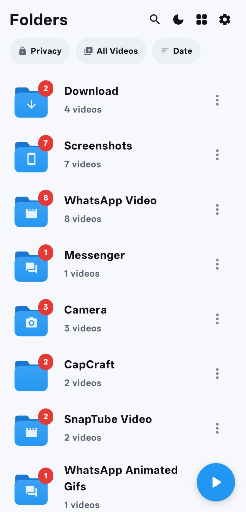
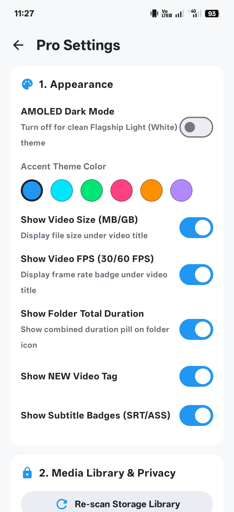

# 🎬 Rinox Player - Pro 4K Video Player for Android

  
  
  
  

**Rinox Player** is a modern, lightweight, and privacy-first **4K Ultra HD Video Player for Android**, built with **Kotlin & Jetpack Compose (Material 3)** and powered by **AndroidX Media3 + NextLib FFmpeg Engine**. Designed for pure performance with zero ads, zero tracking, built-in in-app updates, and ultra-smooth **120Hz / 144Hz** high refresh rate support.

---

## 📸 Screenshots

  
  
  
  

  

---

## ✨ Key Features

* **🚀 Hybrid HW/SW Media3 & FFmpeg Decoder:** Smoothly plays 4K, 8K, 10-bit HDR, MKV, MP4, AVI, MOV, FLV, and all major video formats without lag.
* **⚡ 120Hz / 144Hz High Refresh Rate:** Engineered for flagship displays with zero-load instant cache and buttery-smooth UI transitions.
* **🔒 Built-in Privacy Vault:** Lock and hide your private videos securely inside a local vault.
* **🔄 Built-in In-App Auto-Updater:** Automatically checks GitHub Releases when connected to the internet so you never miss new features or bug fixes.
* **🎛️ 10-Band Audio Equalizer & Bass Boost:** Studio-grade sound customization with multi-track audio and subtitle support (SRT, ASS, VTT).
* **📱 Smart Playback Controls:** Picture-in-Picture (PiP) mode, background audio play, gesture controls for brightness/volume, and smart portrait/landscape auto-rotation.
* **🖤 True Pitch-Black AMOLED UI:** Battery-friendly dark & light themes crafted with Material 3 & Jetpack Compose.
* **🛡️ 100% Ad-Free & Transparent Privacy:** No ads, no analytics, and no user tracking. Internet permission is used strictly to check for app updates from GitHub.

---

## 📥 Download Latest APK

Grab the latest signed APK directly from the [GitHub Releases](https://github.com/rifadhasan3429/Rinox-Player/releases) page or **Orion Store**:
* **`Rinox-Player-arm64-v8a.apk`** — Recommended for all modern 64-bit Android smartphones.
* **`Rinox-Player-armeabi-v7a.apk`** — Compatible with older 32-bit Android devices.

---

## 🛠️ Tech Stack & Architecture

* **Language:** Kotlin
* **UI Framework:** Jetpack Compose (Material 3)
* **Media Engine:** AndroidX Media3 (ExoPlayer) + NextLib FFmpeg Extensions
* **Build System:** Gradle Kotlin DSL + GitHub Actions CI/CD

---

## 👨‍💻 Author & License

Crafted with ❤️ by **Rifad Hasan**  
Licensed under the **GPL-3.0 License**. Feel free to star ⭐ the repository, report issues, or contribute!
